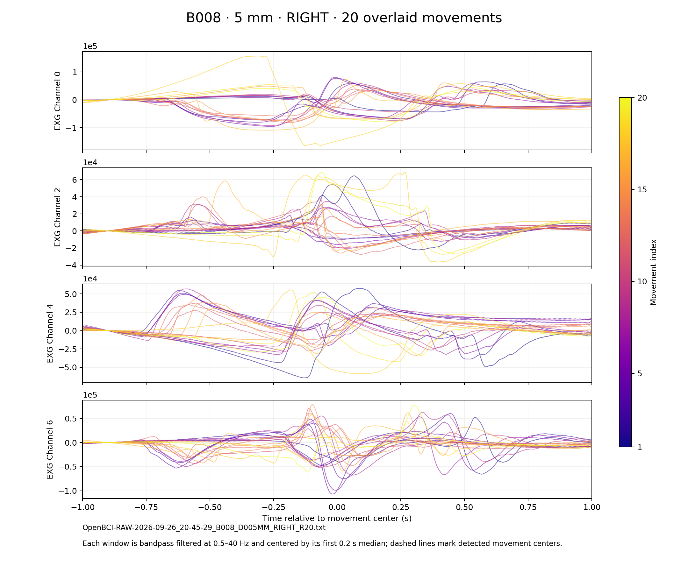
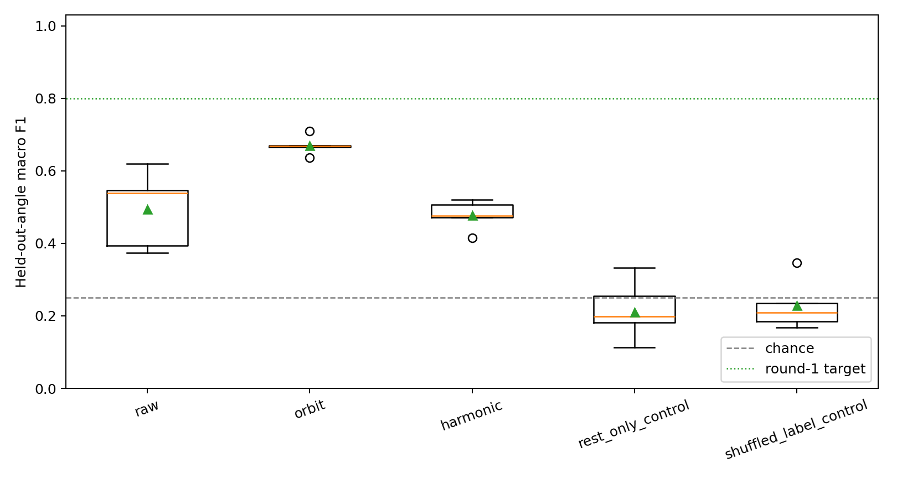

# English figure gallery

Updated 2026-10-01. Figures are included in the standalone repository for reviewing the collection/analysis process. They are historical examples, not new classification results.

## C170 waveform overlays

The five original selected recordings were re-rendered with English labels. Each panel overlays 20 movement windows for one sensor, filtered at 0.5–40 Hz and centered by the first 0.2-second median. These plot baselines differ from the model's window-mean/scale preprocessing. Values retain source EXG units; plots alone do not identify ADC saturation or hardware faults. Colors indicate repetition index and the dashed line indicates the detected movement center.

Numerical traces are exactly equal to the original plotting calculation, as recorded in [figure_conversion_manifest.json](evidence/figure_conversion_manifest.json). The selection contains training, validation and excluded 70 mm examples; no registered-test rows were preprocessed. Preserve the frozen exclusions despite including a 70 mm illustration.

| Figure | Position | Direction | Experimental membership |
|---|---:|---|---|
| [B008](figures/B008_D005MM_RIGHT_R20_overlay.png) | 5 mm | RIGHT | Old validation |
| [B020](figures/B020_D020MM_RIGHT_R20_overlay.png) | 20 mm | RIGHT | Train |
| [B036](figures/B036_D040MM_RIGHT_R20_overlay.png) | 40 mm | RIGHT | Old validation |
| [B058](figures/B058_D070MM_DOWN_R20_overlay.png) | 70 mm | DOWN | Excluded from experiments |
| [B131](figures/B131_D160MM_LEFT_R20_overlay.png) | 160 mm | LEFT | Train |

## Historical W01 held-angle result

The original English figure is preserved byte-for-byte. It displays seed-level held-angle macro-F1 distributions for raw/orbit/harmonic and rest/shuffled controls. The 0.80 target is a fixed acceptance line. The harmonic model was selected by validation; the orbit model's higher test result is a post hoc comparison, not a replacement official selection. The dashed 0.25 line is the four-class reference used in the original visualization; macro-F1 chance depends on prediction distributions and should not be confused with the exact balanced-class accuracy chance rate.

See [full results](EXPERIMENT_RESULTS.md) for numbers, class recalls, protocol deviations and evaluation limits.
