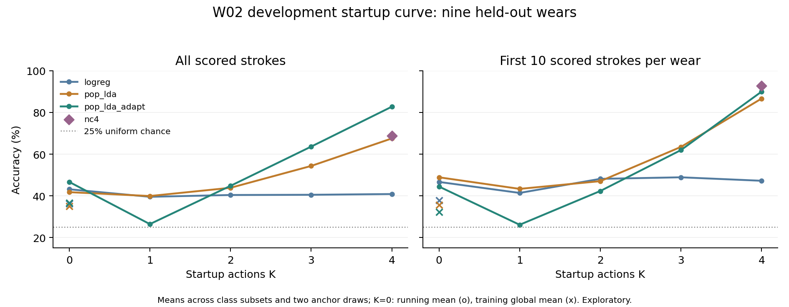

# W02 startup actions and recognition over a wear

Written 2026-10-21. This is a fresh exploratory execution of `scripts.analysis.explore_w02_startup_curve` from commit `e001e3b64342110d485fef39ecfecb0d11604d59`, after pulling `origin/main`. The default experiment completed successfully in 246.875 seconds. All 98 real rows, 490 matched null rows and 19 summary rows were independently checked against the saved per-stroke predictions. No sealed W02 waveform or C170 dataset was accessed.

Four startup strokes, one per direction, plus online population-prototype adaptation gave mean accuracy **82.76%** and mean macro-F1 **0.8233**, averaged over the two anchor draws. Accuracy on the first 10 scored strokes was **90.00%**. Training-free nearest centroid gave **92.78%** on the first 10, but only **68.73%** overall. The adaptive result varies substantially by wear: W06 was **64.66% / 49.14%** across the two draws. These observations support further development of four-action calibration with adaptation; they do not establish dependable use after arbitrary rewearing.



## Protocol and actual access boundary

- Input: `outputs/w02_dev_20261015/dataset.npz`, 1,080 existing presegmented strokes, 54 trial recordings, nine complete wears (120 strokes per wear), one participant. Parts A and B were acquired on October 13 and 14. W01-W06, W08, W09 and W11 are development data used repeatedly for method exploration.
- Leave one complete wear out: fit the population model, scaler, PCA, precision and any global reference using the other eight wears. All six recordings from the held-out wear remain out of population fitting. This is transfer across wears with target-wear startup calibration and optional adaptation, with both acquisition dates represented in development; it is not a held-out-day or held-out-person study.
- The sealed B wears W07/W10/W12 are absent from the input and refused by the runner. Only the development NPZ, its split manifest, and the existing acquisition metadata table were opened. The sealed NPZ was not opened or hashed; its waveform values were not processed. No new test-start marker was needed or created. C170's exposed test was not accessed.
- Class order is **UP, DOWN, LEFT, RIGHT**. Each trial has 20 strokes: an 8-stroke prefix (two per class) and a 12-stroke body (three per class). This experiment scores every stroke other than the selected startup anchors, including all later recording prefixes. Per row, there are `9 * (120 - K)` scored strokes: 1,080 / 1,071 / 1,062 / 1,053 / 1,044 for K=0/1/2/3/4. The first-10 score has 90 strokes per row; positions 1-5 have only 45.
- For K=1..4, enumerate every K-class subset. Draw 0 selects the first occurrence of each chosen class in the first recording's prefix; draw 1 selects the second. All remaining strokes are predicted in recording order. These are alternative analyses of the same data, not independent replications. K=0 has global and running references and a single draw. There are 8/12/8/2 rows per method for K=1/2/3/4, six K=0 rows, and two additional NC4 rows: 98 real rows total.
- Important timing qualification: the selected anchors are **treated as performed first**. If an anchor occurred later in the acquired prefix, the runner uses it to predict unselected earlier strokes. K is the number of selected calibration actions under this reordered-startup assumption, not necessarily the number of actions elapsed in the original recording. The result is causal between scored strokes only after that assumed startup; it is not a literal chronological replay of acquisition. It assumes the instructed direction of each selected calibration action is known.

## Signals, physical order, and models

No raw recording was cropped again. Each stored window has 500 samples (2 s at 250 Hz), centered by the existing prompt-grid localizer. The classifier applies a third-order zero-phase 0.5-12 Hz Butterworth band-pass within the complete current window, then temporal demeaning. Stacking four channels at lags 0,5,...,30 yields a 28x28 covariance with trace-scaled ridge, mapped to 406 tangent features. Zero-phase filtering and prior segmentation mean this is stroke-level prediction after a complete window is available, not sample-level streaming or automatic boundary detection. REST windows in the archive are not used by the classifier.

The current acquisition table was checked for all 63 development trial/REST recordings: every map is **0,1,2,3**, the only channel-map stratum here. The [acquisition protocol](../data_collection/w02_rewear_protocol.md) places S0-S1-S2-S3 in increasing tape order on the right wrist. This is a metadata/protocol check, not a new physical inspection of sensor attachments. The default `--derotate none` leaves stored channel order unchanged; no measured-angle correction or synthetic cyclic reindexing was run. Position below means measured band angle. The data do not validate an equivalence between cyclic channel shifts and anatomical sensor displacement.

References are: mean of selected anchors for K>=1; training-wear mean for K=0 global; mean of preceding held-out strokes for K=0 running (first stroke uses training global). Training running-reference features instead use each entire training recording's covariance mean, a train/deployment reference mismatch. Training anchor features use both draws within each training recording, including those records' anchor strokes in model fitting; no held-out query enters that fitting.

- `logreg`: C=0.1, max_iter=3000, standardized with population-training statistics. Startup actions affect its reference only; their labels do not update the population classifier.
- `pop_lda`: PCA 30 fitted to training features; training class means and Ledoit-Wolf within-class precision after removing recording/class/draw means. A calibrated class adds its one anchor to a prototype with prior count 3.
- `pop_lda_adapt`: same initial model, updating weighted class sums/counts using each scored stroke's soft assignment **after** predicting that stroke. Earlier predictions are never revised and no scored labels enter adaptation.
- `nc4`: K=4 only, one labeled anchor per class, nearest centroid with tangent reference and z-scoring fitted only on the four anchors. Inference needs no population-trained model, though the runner still fits shared models for the other methods in that configuration.

There is no neural training, selected epoch, or validation-based checkpoint selection. Hyperparameters were fixed by the pulled script for this execution. Null seeds are 0,1,2,3,4. PCA uses `svd_solver=auto`, `random_state=None`; the unmodified runner does not set a model RNG seed, so exact numerical reproduction of population-model scores is not guaranteed. All numerical work used one BLAS/OpenMP thread.

## Complete mean startup curve

For K>=1, each entry averages the pooled nine-wear metric equally over class subsets and the two draws. Macro-F1 is the mean of row macro-F1 values, not F1 from pooled repeated predictions. Null accuracy averages five seeds per corresponding row. K=0 rows have no subset/draw averaging. No usable-performance threshold or inferential acceptance gate was pre-registered for this sweep.

| Method | Reference | K | Rows | Accuracy % | Macro-F1 | First 10 % | Null accuracy % |
|---|---|---|---|---|---|---|---|
| logreg | global | 0 | 1 | 36.30 | 0.3601 | 37.78 | 23.85 |
| logreg | running | 0 | 1 | 43.15 | 0.4335 | 46.67 | 23.17 |
| logreg | anchor | 1 | 8 | 39.53 | 0.3775 | 41.39 | 25.09 |
| logreg | anchor | 2 | 12 | 40.40 | 0.3984 | 48.15 | 24.10 |
| logreg | anchor | 3 | 8 | 40.50 | 0.4021 | 48.89 | 23.67 |
| logreg | anchor | 4 | 2 | 40.85 | 0.4077 | 47.22 | 23.62 |
| pop_lda | global | 0 | 1 | 35.09 | 0.3500 | 35.56 | 21.78 |
| pop_lda | running | 0 | 1 | 41.76 | 0.4175 | 48.89 | 19.78 |
| pop_lda | anchor | 1 | 8 | 39.90 | 0.3761 | 43.33 | 24.06 |
| pop_lda | anchor | 2 | 12 | 43.86 | 0.3878 | 47.04 | 25.28 |
| pop_lda | anchor | 3 | 8 | 54.33 | 0.5096 | 63.47 | 26.70 |
| pop_lda | anchor | 4 | 2 | 67.53 | 0.6724 | 86.67 | 27.77 |
| pop_lda_adapt | global | 0 | 1 | 36.67 | 0.3737 | 32.22 | 23.50 |
| pop_lda_adapt | running | 0 | 1 | 46.67 | 0.4545 | 44.44 | 22.72 |
| pop_lda_adapt | anchor | 1 | 8 | 26.44 | 0.2159 | 26.11 | 25.16 |
| pop_lda_adapt | anchor | 2 | 12 | 44.79 | 0.3745 | 42.31 | 25.85 |
| pop_lda_adapt | anchor | 3 | 8 | 63.62 | 0.5855 | 61.94 | 27.09 |
| pop_lda_adapt | anchor | 4 | 2 | 82.76 | 0.8233 | 90.00 | 29.33 |
| nc4 | anchor | 4 | 2 | 68.73 | 0.6849 | 92.78 | 27.26 |

K=0's best observed overall accuracy is 46.67% (running-reference adaptation). K=1 adaptation is near its null (26.44% versus 25.16%). K=2 and K=3 adaptation rise to 44.79% and 63.62%; four class anchors give 82.76%. Logistic regression remains around 40% despite added anchors. The two K=4 adaptive rows are 82.28% / 83.24% accuracy and 0.8171 / 0.8295 macro-F1. Selecting the better draw after observing results would be exploratory selection, not a new validation result.

## Early strokes, later strokes, and recording changes

K=4, averaged across the two draws:

| Method | 1-5 % | 6-10 % | 11-20 % | 21-40 % | 41+ % |
|---|---|---|---|---|---|
| logreg | 48.89 | 45.56 | 41.11 | 41.94 | 39.69 |
| pop_lda | 86.67 | 86.67 | 82.22 | 69.44 | 62.57 |
| pop_lda_adapt | 87.78 | 92.22 | 90.00 | 81.67 | 81.14 |
| nc4 | 93.33 | 92.22 | 79.44 | 75.28 | 62.43 |

| Method | T1 % | T2 % | T3 % | T4 % | T5 % | T6 % |
|---|---|---|---|---|---|---|
| pop_lda_adapt | 91.32 | 81.94 | 83.06 | 80.00 | 79.17 | 82.78 |
| nc4 | 90.62 | 75.28 | 70.56 | 64.17 | 58.61 | 57.50 |

The NC4 result is strongest immediately after calibration and lower in later recordings: 92.78% on positions 1-10, 62.43% at positions 41+, and 57.50% in T6. Adaptation yields 90.00%, 81.14%, and 82.78%, respectively. This is evidence of better persistence for the adaptive method in these recordings, not proof that elapsed time alone causes the difference: recording changes and movement variability are confounded with stream position. The startup prefix and T1 share a recording; high early scores should be interpreted with that within-recording similarity in mind.

## Per-class recall and prediction diversity

Each K=4 row scores 261 examples of each class. Counts below are raw predictions, not normalized percentages; all four classes are predicted in these rows. All 98 real rows' recalls and counts are in `results.json` and `row_metrics.csv`; all 490 null rows' recalls/F1/counts are in `null_metrics.csv`.

| Method | Draw | UP recall % | DOWN recall % | LEFT recall % | RIGHT recall % | Prediction counts (U/D/L/R) |
|---|---|---|---|---|---|---|
| pop_lda_adapt | 0 | 84.67 | 85.06 | 99.23 | 60.15 | 279/258/336/171 |
| pop_lda_adapt | 1 | 75.10 | 84.29 | 99.23 | 74.33 | 229/269/313/233 |
| nc4 | 0 | 65.90 | 61.69 | 83.14 | 60.54 | 229/212/382/221 |
| nc4 | 1 | 64.37 | 54.02 | 91.57 | 68.58 | 244/166/344/290 |

The adaptive d0 row's RIGHT recall is only 60.15% despite 82.28% accuracy, and LEFT is predicted disproportionately often. With incomplete calibration, collapse can be worse: K=3 `UP+DOWN+LEFT`, adaptive d0 predicts RIGHT only **once** among 1,053 queries (prediction counts 296/244/512/1), with 68.57% accuracy and 0.6035 macro-F1. A high aggregate score alone therefore does not establish that all four commands work.

## Per-wear, per-angle, and channel-map strata

K=4, 116 scored strokes per wear per draw:

| Held-out wear | Angle | Adapt d0 % | Adapt d1 % | NC4 d0 % | NC4 d1 % |
|---|---|---|---|---|---|
| W02_P01_A_W01 | 193 | 67.24 | 83.62 | 59.48 | 66.38 |
| W02_P01_A_W02 | 3 | 68.10 | 68.10 | 67.24 | 64.66 |
| W02_P01_A_W03 | 225 | 92.24 | 94.83 | 63.79 | 68.10 |
| W02_P01_A_W04 | 289 | 99.14 | 100.00 | 87.07 | 79.31 |
| W02_P01_A_W05 | 34 | 77.59 | 80.17 | 58.62 | 67.24 |
| W02_P01_A_W06 | 87 | 64.66 | 49.14 | 58.62 | 67.24 |
| W02_P01_B_W08 | 3 | 98.28 | 96.55 | 69.83 | 84.48 |
| W02_P01_B_W09 | 225 | 75.00 | 79.31 | 64.66 | 62.93 |
| W02_P01_B_W11 | 34 | 98.28 | 97.41 | 81.03 | 66.38 |

| Band angle | Adapt d0 % | Adapt d1 % | NC4 d0 % | NC4 d1 % |
|---|---|---|---|---|
| 3 | 83.19 | 82.33 | 68.53 | 74.57 |
| 34 | 87.93 | 88.79 | 69.83 | 66.81 |
| 87 | 64.66 | 49.14 | 58.62 | 67.24 |
| 193 | 67.24 | 83.62 | 59.48 | 66.38 |
| 225 | 83.62 | 87.07 | 64.22 | 65.52 |
| 289 | 99.14 | 100.00 | 87.07 | 79.31 |

Angle values 3, 34 and 225 degrees each combine two development wears; 87, 193 and 289 degrees each have one. Unequal angle coverage and one participant limit comparisons. The only channel-map stratum is `0,1,2,3`, so its pooled metrics equal the corresponding overall metrics above; there is no comparison between channel maps. W06 at 87 degrees remains a large failure case, and a good average cannot establish uniform physical rotation robustness.

## Matched recording-block label permutations

Each seed draws one four-class permutation within each recording; all strokes of a given class in that recording receive the same relabeling. Training wears are refitted under those labels; held-out first-recording anchor selection also uses the permuted labels. Queries are scored against original true labels. Thus calibration identities and excluded-anchor masks can differ between real and null rows for K<4; at K=4 the two draws still select one occurrence of every true class, so their anchor sets match. The sequential update/reference rule and action count remain matched.

| Method | Draw | Seed 0 % | Seed 1 % | Seed 2 % | Seed 3 % | Seed 4 % |
|---|---|---|---|---|---|---|
| pop_lda_adapt | 0 | 15.80 | 52.87 | 28.45 | 38.79 | 12.36 |
| pop_lda_adapt | 1 | 13.89 | 51.15 | 32.85 | 36.11 | 11.02 |
| nc4 | 0 | 20.02 | 40.23 | 26.34 | 32.09 | 16.57 |
| nc4 | 1 | 17.72 | 42.62 | 26.25 | 32.38 | 18.39 |

The K=4 adaptive null mean is 29.33%, with individual seed/draw values spanning 11.02%-52.87%; NC4's null mean is 27.26%. Nulls are not uniformly near 25% in only nine wears, and recording-level mappings can preserve appreciable apparent signal. Report the observed controls, not a fixed chance assumption. Five seeds, repeated exploratory model development, and correlated subset/draw rows do not support a confirmatory p-value or independent replication claim. The figure's 25% line is only uniform four-class chance.

## Execution, verification, and provenance

The user's command was executed with the project's working `.venv` interpreter; the default shell Python lacked SciPy. Equivalent explicit command:

```powershell
$env:OPENBLAS_NUM_THREADS = '1'
$env:OMP_NUM_THREADS = '1'
$env:MKL_NUM_THREADS = '1'
./.venv/Scripts/python.exe -u -m scripts.analysis.explore_w02_startup_curve --output-dir outputs/w02_explore_20261015/startup_curve_v1
```

An exclusive Python tee wrapper captured both stdout and stderr to `outputs/w02_explore_20261015/startup_curve_v1.log` and saved the actual child exit status. It wrote preflight metadata before launching the module. Output directory and log did not exist; the runner uses `mkdir(exist_ok=False)`. For a new execution use a fresh directory **and** log. No existing run or original accepted recording was overwritten. The pulled analysis/model sources were not edited.

Started 2026-10-21T12:46:43.837454+00:00; finished 2026-10-21T12:50:52.760063+00:00 (UTC), on October 21 in Asia/Hong_Kong. Environment: Python 3.10.6, NumPy 1.23.5, SciPy 1.10.1, scikit-learn 1.3.2; CPU numerical methods, no CUDA/neural training. The earlier October 15 string in the output path is retained from the requested command; this was run on October 21.

| Input/source | SHA-256 |
|---|---|
| outputs/w02_dev_20261015/dataset.npz | `f5ec8530ab51a3114e6b7909678ec8ca2ebe1bf8073f4c326433c04af43ea764` |
| scripts/analysis/explore_w02_startup_curve.py | `d47556db87bf5d81c601ca587c6f589079c5475a8a23ed4fa01abc4faa511420` |
| src/w02_cov_fewshot.py | `0043aacc09853cb90af98b91736c6f3fe9dd16a1ece62ca0f91bee6dc554af8a` |
| src/v21_data.py | `6f03523ce716046cbee555aa0990bec8b42d3e725e25bfa057e741028e8829e5` |

The verifier independently reconstructed every real/null excluded-anchor mask and stream ordering, checked exact configuration coverage, recomputed accuracy, macro-F1, recalls, prediction counts, stream-position bins, per-recording, per-wear and per-angle metrics, and checked all summary means/minima/null means within 1e-12. It verified input/source hashes before accepting success. This verifies saved predictions and reporting, not a second fit of the population models or a fresh physical-order inspection.

Focused tests cover existing covariance recipes and segmentation: **4 passed in 3.09 s**. The first pytest invocation failed during NumPy DLL import under file-descriptor capture (WinError 1114, invalid Windows handle); importing NumPy before `pytest.main` passed the same tests in the same environment. Both logs remain local; the passing log is included in the compact evidence. No implementation was changed to address the test-launch environment. The full repository suite was not run.

Compact portable evidence: [bundle index](../evidence/w02_startup_curve_20261021/README.md), [all rows and summaries](../evidence/w02_startup_curve_20261021/results.json), [summary CSV](../evidence/w02_startup_curve_20261021/summary.csv), [real row CSV](../evidence/w02_startup_curve_20261021/row_metrics.csv), [null CSV](../evidence/w02_startup_curve_20261021/null_metrics.csv), [verification](../evidence/w02_startup_curve_20261021/verification.json), and [hash manifest](../evidence/w02_startup_curve_20261021/manifest.json). Full predictions, sample metadata, package list, initial failed test log, wrappers and full experiment log remain under ignored `outputs/`; the manifest records their current hashes. Current-run hashes describe the actually executed English sources; no historical pre-translation hash was rewritten.

## Interpretation boundary

These results compare startup and sequential classification of already segmented UP/DOWN/LEFT/RIGHT strokes. They do not establish continuous detection, handwriting transcription, open-vocabulary recognition, mathematical invariance, or synthetic cyclic-shift invariance. They provide exploratory evidence of calibration and adaptation across repeated wears of one participant, with mixed-day training and evaluation. They do not establish cross-person or independent cross-day generalization. The older per-recording NC4/body-only result cannot be compared directly: this sweep calibrates once per wear and scores all non-anchor strokes across six recordings.

The strongest direction from this run is a four-action prototype model that adapts after each prediction, with explicit attention to RIGHT recall and W06 failures. This is a development conclusion. Any confirmatory evaluation still requires freezing the complete inference/startup protocol before opening the sealed wears, and must state whether calibration actions are newly acquired first or selected retrospectively as here. The sealed wears remain untouched by this task.
