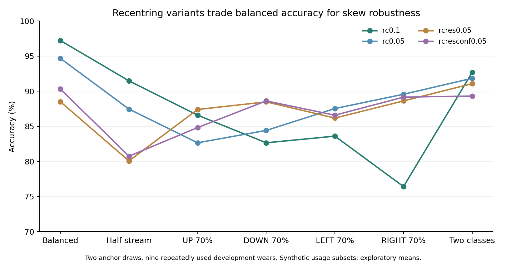
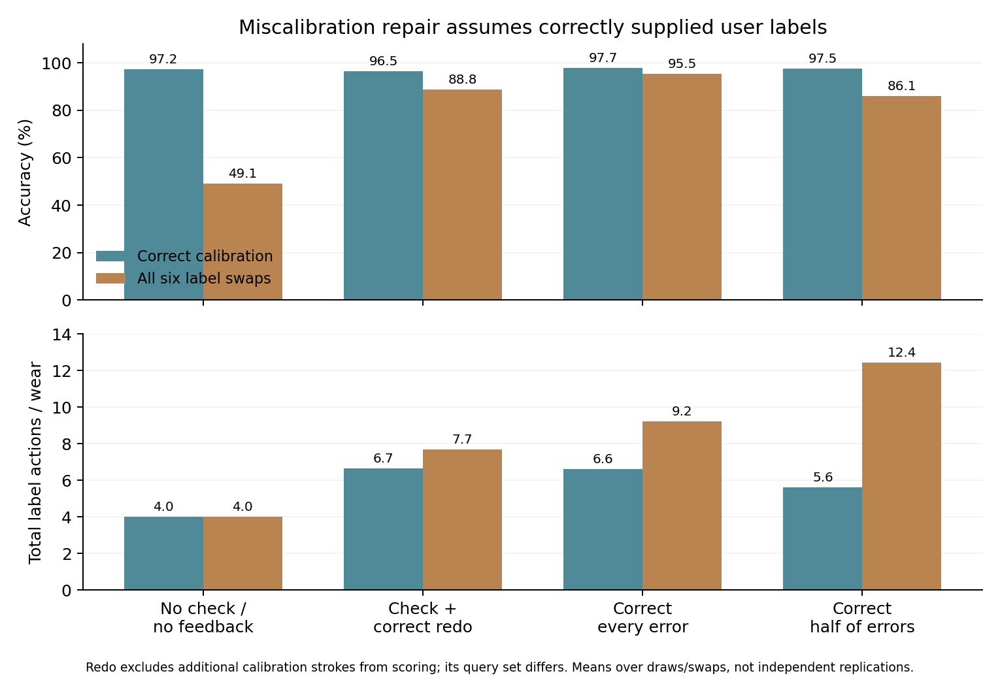

# W02 family G: recentering robustness and miscalibration repair

Written 2026-10-21. Fresh execution of `launch_w02_stream_families --jobs G_robust` after pulling commit `10ff6cde6d17b56d26bf701f4d00c6c157e1c6b0`. The G child completed in **62.3 seconds**, exit 0; the launcher wrapper completed in 64.5 seconds. This produced **1,156 real rows, 5,500 original anchor-permutation controls and 448 summaries**. All real metrics and all original control accuracies/counts were verified, including replayed control predictions. The sealed W02 wears and C170 waveforms were not accessed.

The proposed fixes have limits. Residual/gated recentering improves some skewed-use cases while reducing balanced-use performance; it does not dominate the earlier EMA recipe. A simple reduction from EMA .10 to .05 gives **94.68% balanced accuracy** and a **82.66% minimum scenario mean**, versus **97.22% / 76.42%** for .10. The population-based calibration check flags **66.67% of correct calibrations**. Under the assumed six two-label swaps, correcting every error restores mean accuracy to **95.50%** at **9.22 total label actions per wear**; the simulation assumes immediate, correct user feedback. These are exploratory findings on repeatedly used development wears, not a confirmatory acceptance result.



## Data, scope and execution boundary

Only the requested G job was launched; A-F were not rerun. Input was `outputs/w02_dev_20261015/dataset.npz`: 1,080 existing 500-sample four-channel strokes from 54 trial recordings and nine complete wears (A W01-W06; B W08/W09/W11), one participant recorded on October 13 and 14. Class order is **UP, DOWN, LEFT, RIGHT**, 270 strokes per class. Each wear has six 20-stroke recordings; each recording begins with two prefix occurrences of each class. Unique recording/stroke identities were checked; W02 has no marked duplicate field.

All population statistics exclude the **entire held-out wear**. For part 1, other wears supply only the std of features centered within training recordings; their class labels are unused. Part 2 additionally fits class prototypes using training labels. Target adaptation uses selected calibration strokes and past scored strokes. This is mixed-date rewearing development, not an untouched cross-day or cross-person test.

The supplied archive excludes sealed B W07/W10/W12, and the loader refuses their presence. The sealed NPZ was neither opened nor hashed. No sealed test-start marker was created; no C170 waveform or exposed C170 test was accessed. Only development arrays and existing accepted plans/acquisition metadata were read. No raw accepted recording was modified or recut. The requested output root and adjacent metadata/logs were absent; all were created exclusively. All original outputs and exit records are retained.

Preflight was recorded at 2026-10-21T14:23:01.697058+00:00; the G child finished 2026-10-21T14:24:07.902015+00:00 (UTC), on October 21 in Asia/Hong_Kong. The October 15 string in the output path is retained from the requested command. A successful launcher exit alone is insufficient: `G_robust.exit.json`, result completeness and hashes were checked independently.

## Signals, physical order and startup chronology

Each presegmented window is 2 seconds at 250 Hz. Features use third-order zero-phase 0.5-12 Hz Butterworth filtering, temporal demeaning, lags 0,5,...,30, a trace-ridged 28x28 covariance and 406 log-Euclidean coordinates. Filtering uses the complete current window; this is not sample-level streaming or continuous movement detection. REST windows are not used. Population scales fit on training wears only. G has no neural epochs, selected checkpoint, PCA or stochastic learned model; the numerical replay is deterministic in the recorded environment.

Fresh checks of all 63 development trial/REST acquisition rows find one channel-map stratum, **0,1,2,3**. The [physical protocol](../data_collection/w02_rewear_protocol.md) orders S0-S1-S2-S3 along increasing tape readings on the right wrist. This validates the metadata/protocol assumption, not a new anatomical inspection. No cyclic channel transformation was run in G. Cyclic reindexing and moving sensors anatomically remain distinct transformations. Each channel-stratum metric here equals its corresponding pooled metric because only one map occurs.

Four startup anchors are selected from T1: draw 0 uses the first occurrence of each true class, draw 1 the second. Anchors are treated as performed first, so unselected earlier acquired strokes may be scored afterward. This assumes a reordered startup, not literal acquisition-order replay. All remaining strokes, including later recordings' prefixes, are scored in temporal order; predictions occur before updates. Without a redo, every row has **1,044 scored strokes**, 116 per wear, before usage subsampling. Draws and perturbations reuse the same data and are not independent replications.

Miscalibration is simulated by exchanging **two anchor labels**, enumerating all six class pairs and both draws. Each row applies the same class-pair swap across wears. This is a bijective two-label error surrogate, not a recording of an actual incorrectly executed calibration gesture, a missing class, or a repeated same-direction action. It differs from family F's single seeded swap choice per wear; 49.07% here and the earlier 48.75% are not the same swap aggregation.

The 20 family F usage scenarios comprise balanced use, half-stream sampling, dominant-class target shares .40/.55/.70, one class omitted in T2-T4, UP/DOWN-only use after T1, and miscalibration. The last scenario expands to six swaps: 25 scenario/swap conditions x 22 pipelines x two draws = **1,100 part-1 real rows**, each with five original controls. Part 2 has 14 check+redo rows; part 3 has 42 correction rows.

## Part 1: recentering trades rather than a universal repair

All pipelines initialize class prototypes from the anchors, use nearest prototype with training-wear scaling, and (except `static`) cumulatively update the predicted class. `adapt` never recenters. `rc` tracks a global feature EMA; `rcconf` moves it only at margin >= .2. `rcres` instead adds beta times the residual unexplained by the predicted class's **pre-update** prototype; `rcresconf` gates that residual update at margin >= .2. Beta spans .05/.10/.15/.20/.30. Every scored stroke is predicted before prototype/reference updates.

The table's mean and minimum use the **19 non-miscalibration scenario means**, each averaged over two draws. Equal scenario weighting is a descriptive post-sweep statistic, not an observed deployment frequency distribution. The minimum is neither a worst-wear score nor a worst individual draw. Scenarios overlap and have different class mixtures/denominators. All pipelines are shown, avoiding selection of a favorable usage case alone.

| Pipeline | Balanced % | Mean of 19 scenarios % | Worst scenario mean % | RIGHT ~70% % | Six-swap miscal % |
|---|---|---|---|---|---|
| static | 77.01 | 77.38 | 70.73 | 70.73 | 42.34 |
| adapt | 91.52 | 87.24 | 80.17 | 89.84 | 47.17 |
| rc0.05 | 94.68 | 89.83 | 82.66 | 89.57 | 48.23 |
| rc0.1 | 97.22 | 90.02 | 76.42 | 76.42 | 49.07 |
| rc0.15 | 96.98 | 89.91 | 76.29 | 76.29 | 48.99 |
| rc0.2 | 96.60 | 89.78 | 76.56 | 76.56 | 48.87 |
| rc0.3 | 96.26 | 88.74 | 77.37 | 77.37 | 48.75 |
| rcconf0.05 | 94.01 | 88.43 | 82.38 | 88.75 | 48.00 |
| rcconf0.1 | 94.92 | 86.46 | 73.04 | 73.04 | 48.31 |
| rcconf0.15 | 95.31 | 86.38 | 74.93 | 74.93 | 48.44 |
| rcconf0.2 | 92.72 | 85.16 | 71.68 | 74.12 | 47.57 |
| rcconf0.3 | 92.19 | 83.43 | 70.73 | 70.73 | 47.40 |
| rcres0.05 | 88.51 | 85.93 | 80.08 | 88.62 | 46.17 |
| rcres0.1 | 85.92 | 85.36 | 80.17 | 87.94 | 45.31 |
| rcres0.15 | 83.29 | 83.69 | 79.04 | 84.15 | 44.43 |
| rcres0.2 | 83.43 | 82.34 | 76.31 | 83.74 | 44.48 |
| rcres0.3 | 82.47 | 80.43 | 73.58 | 75.88 | 44.16 |
| rcresconf0.05 | 90.33 | 86.74 | 80.75 | 89.16 | 46.78 |
| rcresconf0.1 | 88.51 | 85.53 | 80.46 | 87.26 | 46.17 |
| rcresconf0.15 | 86.25 | 84.68 | 80.08 | 87.13 | 45.42 |
| rcresconf0.2 | 85.73 | 83.91 | 80.27 | 83.88 | 45.24 |
| rcresconf0.3 | 83.76 | 82.21 | 76.56 | 76.56 | 44.59 |

The simpler `rc0.05` has the highest minimum of these 19 scenario means in this grid. The best residual-family mean is `rcresconf0.05` (86.74% across scenarios), below 90.02% for `rc0.1`. For RIGHT-dominant use it improves 76.42% to 89.16%, but balanced accuracy falls 97.22% to 90.33%; its worst balanced wear/draw is also lower. This is not a uniform improvement. No unlabeled recentering variant repairs the semantic label swaps: their miscalibration means remain approximately 42-49%.

### Class recall, prediction diversity and position strata

Values below average per-row metrics, rather than pooling overlapping queries from different perturbations. In particular, high dominant-class accuracy can coexist with poor minority recall.

| Case | Mean accuracy % | Mean macro-F1 | UP recall % | DOWN recall % | LEFT recall % | RIGHT recall % |
|---|---|---|---|---|---|---|
| Balanced / rc0.1 | 97.22 | 0.9722 | 95.02 | 97.13 | 99.43 | 97.32 |
| Balanced / rc0.05 | 94.68 | 0.9467 | 91.95 | 96.36 | 98.85 | 91.57 |
| Balanced / rcresconf0.05 | 90.33 | 0.9026 | 92.34 | 89.85 | 93.30 | 85.82 |
| RIGHT 70% / rc0.1 | 76.42 | 0.6968 | 76.45 | 74.02 | 78.77 | 76.44 |
| RIGHT 70% / rc0.05 | 89.57 | 0.8259 | 76.48 | 71.17 | 83.36 | 94.83 |
| RIGHT 70% / rcresconf0.05 | 89.16 | 0.7912 | 60.90 | 54.84 | 77.11 | 99.62 |
| Miscal / feedback_correct | 95.50 | 0.9550 | 94.48 | 95.31 | 97.51 | 94.70 |

| Held-out wear | Band angle | rc0.1 % | rc0.05 % | rcresconf0.05 % |
|---|---|---|---|---|
| W02_P01_A_W01 | 193 | 92.67 | 71.55 | 70.69 |
| W02_P01_A_W02 | 3 | 96.98 | 96.98 | 68.10 |
| W02_P01_A_W03 | 225 | 99.14 | 100.00 | 99.14 |
| W02_P01_A_W04 | 289 | 100.00 | 100.00 | 100.00 |
| W02_P01_A_W05 | 34 | 96.55 | 94.83 | 86.21 |
| W02_P01_A_W06 | 87 | 91.81 | 91.38 | 90.52 |
| W02_P01_B_W08 | 3 | 97.84 | 97.41 | 98.28 |
| W02_P01_B_W09 | 225 | 100.00 | 100.00 | 100.00 |
| W02_P01_B_W11 | 34 | 100.00 | 100.00 | 100.00 |

| Balanced pipeline | 1-5 % | 6-10 % | 11-20 % | 21-40 % | 41+ % | T6 % |
|---|---|---|---|---|---|---|
| rc0.1 | 98.89 | 98.89 | 100.00 | 97.50 | 96.56 | 93.33 |
| rc0.05 | 95.56 | 95.56 | 97.22 | 93.89 | 94.44 | 91.11 |
| rcresconf0.05 | 95.56 | 95.56 | 92.78 | 90.28 | 89.33 | 84.17 |

The table lists physical band angles alongside all nine wears; pooled per-angle scores, per-draw recalls, true class counts, predicted counts, stream bins, per-recording and coarse time-bin scores for **every row** are in `row_metrics.csv`. Angles 3/34/225 degrees have two development wears each; 87/193/289 one each. Time bins use the recording's accepted filename start time for every stroke in that recording, not exact per-stroke elapsed time. They do not isolate a causal time-drift effect.

## Part 2: the calibration check mostly flags

The check compares four anchor vectors, centered at their mean and scaled with training std, against class prototypes fit on other wears. A Hungarian one-to-one assignment chooses a forced four-class mapping; **any** disagreement with supplied labels flags the calibration. Its training labels are a new labeled dependency beyond part 1.

| Check condition | Flagged / cases | Flag rate % |
|---|---|---|
| Correct calibration (false alarm) | 12/18 | 66.67 |
| Swap UP / DOWN | 18/18 | 100.00 |
| Swap UP / LEFT | 18/18 | 100.00 |
| Swap UP / RIGHT | 16/18 | 88.89 |
| Swap DOWN / LEFT | 18/18 | 100.00 |
| Swap DOWN / RIGHT | 18/18 | 100.00 |
| Swap LEFT / RIGHT | 12/18 | 66.67 |
| All swaps (detection) | 100/108 | 92.59 |
| Permuted calibration labels | 85/90 | 94.44 |

There are only 18 correct calibration sets (nine wears x two draws), repeatedly reused for 108 swapped sets; these are not 108 new independent calibrations. A 92.59% swapped-label detection rate is weak evidence of usefulness when 12/18 correct sets are also rejected. The 94.44% flag rate on permuted anchor labels shows that the check usually flags alternatives. No real-world calibration-error prevalence or predictive precision was measured.

For `check_redo`, a flagged set is assumed to be redone **correctly** using the other four prefix occurrences. Both the first four and replacement four anchors are removed from scoring; four extra label actions are counted. Correct-calibration rows therefore score 1,020 strokes, and swapped rows 1,008/1,016/1,024 depending on which wears are flagged. These query sets differ from the 1,044-stroke no-redo rows. The extra redo cost is stored on the first remaining query for position-bin accounting, while the initial four actions are added to the overall cost separately. The result does not establish automatic repair or that an actual second attempt would be correct.

## Part 3: corrections can repair the assumed label errors



The feedback simulation uses the family D update loop at EMA .1. It either corrects every observed error, corrects each error with probability .5, or supplies no corrections. Each stroke is scored before its corrective label changes a prototype. Every initial label, correction or redo label counts as one action. User error detection, label correctness and immediate availability are oracle assumptions; actual interaction latency and UI cost were not measured. All G feedback rows keep all four prototypes active and produce no abstentions, so their reported F1/counts represent actual class predictions, unlike the earlier D no-action substitution cases.

| Condition | Intervention | Accuracy % | Minimum row % | Mean macro-F1 | Total label actions/wear | Scored strokes/row |
|---|---|---|---|---|---|---|
| correct | check_redo+rc0.1 | 96.47 | 95.29 | 0.9646 | 6.67 | 1020 |
| miscal | check_redo+rc0.1 | 88.84 | 71.09 | 0.8867 | 7.70 | 1008/1016/1024 |
| correct | feedback_none | 97.22 | 97.13 | 0.9722 | 4.00 | 1044 |
| correct | feedback_correct | 97.75 | 97.70 | 0.9775 | 6.61 | 1044 |
| correct | feedback_correct_p50 | 97.46 | 97.41 | 0.9746 | 5.61 | 1044 |
| miscal | feedback_none | 49.07 | 47.89 | 0.4907 | 4.00 | 1044 |
| miscal | feedback_correct | 95.50 | 94.92 | 0.9550 | 9.22 | 1044 |
| miscal | feedback_correct_p50 | 86.10 | 75.48 | 0.8616 | 12.43 | 1044 |

Without feedback, the twelve swapped rows average 49.07%. Correcting every error gives 95.50% accuracy, 0.9550 mean macro-F1 and 9.22 total label actions per wear (including four startup actions), with minimum wear/draw/swap accuracy 87.93%. Half-error correction gives 86.10% and **12.43** actions per wear in this simulation: unrepaired errors persist and can require more subsequent labels. These are modelled interaction trajectories, not evidence from people using a deployed interface.

Check+redo reaches 88.84% at 7.70 actions per wear under swaps, but its worst pooled swap/draw row is 71.09%, its worst wear case 43.97%, and it assumes a correct redo on a changed query set. With initially correct calibration, false alarms raise its cost to 6.67 labels and accuracy is 96.47%, compared with 97.22% and four labels without checking. The high false-alarm rate therefore matters even when no calibration error occurred.

## Original and supplementary controls

Part 1's only label-dependent inputs are the anchor class names. Its original controls permute them with `default_rng([seed, wear_index])`, seeds 0-4, after the specified swap when present. Training scales are label-free, so permuting training labels cannot change them. All **5,500** original null trajectories were regenerated from features with the executed stream function, checked against their saved accuracies/counts, and retained as new audit prediction arrays; null F1, per-class recall and prediction counts are exported. They are consistency replays of this implementation, not an independent implementation of the model.

Part 2 originally checks permuted anchor labels against **true-label-trained** population prototypes; it does not refit them under matched training-block permutations. Parts 2 and 3 originally provide no stream-score nulls. Additional controls were therefore run separately after the sweep, without modifying or relabeling original G artifacts:

- **90 calibration-check cases:** five recording-block class permutations x nine wears x two draws, refitting population class prototypes under permuted training labels and using consistently permuted target calibration labels. The correct-under-null flag rate is 94.44%; the swap flag rate is 95.19%. This probes the supervised check's label dependency, not a check+redo recognition score.
- **210 feedback control rows:** all 42 part-3 configurations x five recording-block teacher permutations, applied consistently to teacher/error judgements and anchor labels while retaining the stated swaps, feedback RNG and original true-row query masks. Population scaling has no training-label fit. Scores remain against original true labels; these control predictions and action costs were saved.

| Condition | Feedback policy | Real accuracy % | Recording-block null % | Null row range % |
|---|---|---|---|---|
| correct | feedback_none | 97.22 | 30.59 | 11.30-57.38 |
| correct | feedback_correct | 97.75 | 24.61 | 13.89-35.25 |
| correct | feedback_correct_p50 | 97.46 | 28.92 | 11.78-50.38 |
| miscal | feedback_none | 49.07 | 26.86 | 3.16-50.10 |
| miscal | feedback_correct | 95.50 | 24.11 | 13.41-34.96 |
| miscal | feedback_correct_p50 | 86.10 | 27.67 | 8.81-50.00 |

The wide control ranges and overlapping wear/draw/swap analyses prohibit an independent-replication or confirmatory p-value claim. No check+redo stream null was added, so that intervention has no matched stream-null result in this report. This boundary is explicit instead of treating the original check's permuted-label flag rate as such a result.

## Verification and reproducibility

Fresh verification covered exact Cartesian configuration/prediction-key coverage; independently rebuilt real query masks/order; all real accuracy/F1/recall/counts, wear/angle/recording/boundary/position/minute scores; original control accuracy/count replay; the 216 original raw check flags; all 56 part-2/3 prediction and action trajectories; and all 448 summary means/minima/null/action means. The metric/mask functions were independently written for the earlier family audit and reused with fresh data; check assignments, redo masks and costs were newly reconstructed. Stream replays use the supplied stream functions. The 152 comparable non-miscalibration F baseline rows have exactly matching saved predictions, an implementation consistency check on the same data rather than new independent evidence.

Existing covariance and segmentation tests passed: **4 passed in 2.08 s**, importing NumPy before pytest output capture. No source code was changed and the full repository suite was not run. Original failed/partial artifacts were not overwritten; this execution and audit completed without a failed job.

Executed command, using the working project environment:

```powershell
./.venv/Scripts/python.exe -u -m scripts.analysis.launch_w02_stream_families --root outputs/w02_explore_20261015/stream_families_G_v1 --jobs G_robust
```

The child receives `OPENBLAS_NUM_THREADS=OMP_NUM_THREADS=MKL_NUM_THREADS=1`. Python 3.10.6, NumPy 1.23.5, SciPy 1.10.1, scikit-learn 1.3.2 were used. No CUDA or neural training ran. Usage subsampling uses `[wear_index, draw, 7]`; partial feedback uses `[wear_index, draw, swap_index, 13]`; swap pairs enumerate UP/DOWN, UP/LEFT, UP/RIGHT, DOWN/LEFT, DOWN/RIGHT, LEFT/RIGHT. Supplementary block permutations use `v21_data.block_permuted_labels` with seeds 0-4 over sorted recording groups. No epoch/checkpoint selection applies.

| Source/input | SHA-256 |
|---|---|
| outputs/w02_dev_20261015/dataset.npz | `f5ec8530ab51a3114e6b7909678ec8ca2ebe1bf8073f4c326433c04af43ea764` |
| scripts/analysis/launch_w02_stream_families.py | `d5925aa55090723e682e3fbbd2e0376b90a8013183dc52a0ece99b8fd678eef1` |
| scripts/analysis/explore_w02_stream_robust.py | `89aea0c82fadb5ab6053f58172fb4e59eed10824239569d7a61f7a55324a7d5c` |
| scripts/analysis/w02_stream_lib.py | `257ea0fa889e6f4e76e2380d4758b20095e8aadf36fbaa4a460a78c2fbf6a15d` |
| scripts/analysis/explore_w02_stream_feedback.py | `484aa720a7bc653e0f61e2475405bd9274868909fc6a16a4678ffc513f39ea72` |
| scripts/analysis/explore_w02_stream_usage.py | `7763d817648b1840a0b2307cdeeba8873e66ff3170e907ae91fa66495627bb30` |
| src/v21_data.py | `6f03523ce716046cbee555aa0990bec8b42d3e725e25bfa057e741028e8829e5` |
| src/w02_cov_fewshot.py | `0043aacc09853cb90af98b91736c6f3fe9dd16a1ece62ca0f91bee6dc554af8a` |

Accepted-plan hashes, precise commands and environment are in [preflight](../evidence/w02_stream_G_20261021/preflight.json). The [compact evidence bundle](../evidence/w02_stream_G_20261021/README.md) contains every real metric row, all replayed original null metrics, all summaries/check flags, interaction costs, supplementary controls, figures and verification. Full original result/prediction arrays, original logs, replayed null/control arrays, packages and analysis helpers stay in ignored `outputs/`; their current hashes are in the manifest. The actually executed English sources are hashed without rewriting any historical/pre-translation run hash. Use a new root and logs for another execution; preserve incomplete outputs and exit markers.

## Interpretation boundary

This run does not establish that unbalanced use or calibration errors have been solved. EMA rate .05 is a useful descriptive tradeoff within the tested usage grid; residual/gated updates do not provide a universal gain. The population-based check has too many false alarms in these samples, and simulated correct labels can repair errors at a measurable additional action cost. Recipe selection and all scenario comparisons remain exploratory on the same repeatedly used nine development wears.

The task is four-way classification of already segmented strokes. It establishes neither continuous detection, handwriting transcription, open-vocabulary recognition, mathematical invariance, synthetic transformation invariance, nor uniform physical sensor relocation robustness. It is mixed-date single-participant rewearing evidence; it is not an independent cross-day or cross-person result. Future confirmation requires freezing startup chronology, calibration checks, update rules, feedback/redo assumptions and scoring before opening an untouched holdout. No sealed evaluation was performed or authorized here.
