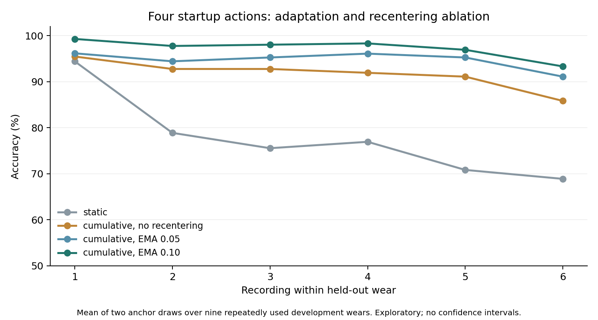
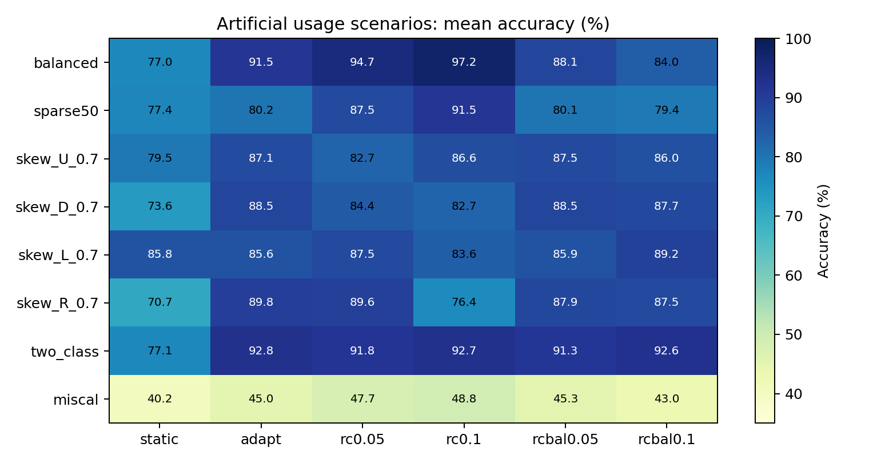

# W02 stream families: calibration, adaptation, feedback, and drift

Written 2026-10-21. This records a fresh execution of `scripts.analysis.launch_w02_stream_families` after pulling commit `4e6e10a3fe54e56a53d7ee94c11239fbf62d2e80`. All eight jobs exited with code 0; wall time was 175.031 seconds. The experiment produced **1,563 real rows and 7,815 original control aggregates**, plus the family E diagnostic. Every real row's saved predictions and metrics were checked. All results are exploratory development results; no sealed W02 waveform or C170 dataset was accessed.

The strongest four-action configuration in family A used calibration-only prototypes, training-wear feature scaling, cumulative self-updates and online recentering: **97.22% accuracy, 0.9722 mean macro-F1**, averaged over the two calibration draws. It achieved **98.89%** on the first ten scored strokes and **93.33%** in the sixth recording. This is a post-sweep selection among 220 K=4 configurations, not a confirmatory score. Artificially skewed usage and miscalibration expose substantial failures; fewer startup actions and user feedback have distinct costs and assumptions.



## Execution and data boundary

| Job | Real rows | Exit | Elapsed seconds |
|---|---|---|---|
| A_adapt | 660 | 0 | 172.8 |
| B_features | 175 | 0 | 92.5 |
| C_fewer_b0.1 | 87 | 0 | 30.2 |
| C_fewer_b0.05 | 87 | 0 | 30.2 |
| D_feedback_b0.1 | 117 | 0 | 44.2 |
| D_feedback_b0.05 | 117 | 0 | 44.2 |
| E_drift | 0 | 0 | 6.0 |
| F_usage | 320 | 0 | 30.2 |

The launcher starts eight operating-system processes with one BLAS/OpenMP thread per child. Its own successful exit does not establish child success; all eight exclusive child exit files and result files were checked separately. The requested root `outputs/w02_explore_20261015/stream_families_v1` did not exist. Preflight, launcher log and launcher exit status were recorded next to it, and all child logs remain inside it. No experiment source was edited, no run was overwritten, and no raw accepted recording was changed. The October 15 path component is retained from the user's command; execution was on October 21.

Input is the existing **1,080 x 500 x 4** W02 development archive, with nine complete wears: A W01-W06 and B W08/W09/W11, 120 strokes and six trial recordings per wear, one participant across October 13 and 14. Class order is **UP, DOWN, LEFT, RIGHT**, 270 strokes per class. Each recording has eight prefix strokes (two per class) and twelve body strokes (three per class). All non-anchor strokes are scored, including later recordings' prefixes; this is not body-only scoring with recalibration in every recording. K=0/1/2/3/4/8 generally score 1,080/1,071/1,062/1,053/1,044/1,008 strokes per row; family F subsamples them. Unique recording/stroke identities were checked; W02 has no marked duplicate field.

For every population-dependent method, the held-out **complete wear** is excluded from population fitting. Training means/scales/PCA/precision/transform choices use the other eight wears as required by each method. Per-stroke filtering/features are computed independently; references generally use startup anchors or past scored strokes. K=0 in C/D initializes the reference from the current first stroke, with no future stroke involved. Training recording means are allowed to use complete training recordings. Family E explicitly uses all target labels and batch statistics as a diagnostic. Family F uses true labels to construct simulated usage scenarios, not as online prediction inputs.

The sealed B wears W07/W10/W12 are absent and refused by the development loader. The sealed NPZ was neither opened nor hashed, and no test-start marker was created. Only the development NPZ and existing acquisition plans/metadata were accessed. Parts A and B both contribute training/evaluation wears: this is mixed-date rewearing development, not an independent held-out-day or held-out-person test. C170's previously exposed test was not accessed.

## Startup chronology, signals, and physical order

K=4 selects the first or second occurrence of every direction from the **first recording's prefix** (draws 0/1). K=8 takes both occurrences. Smaller K enumerates selected classes. The selected anchors are treated as performed first; unselected strokes that occurred earlier during acquisition can then be scored. Consequently the result assumes a reordered startup and is causal between later scored strokes under that assumption. It is not a literal replay of the original acquisition chronology, and K is not necessarily the original elapsed action count. Prompt directions of calibration strokes are assumed known.

No recropping occurred: each existing prompt-grid window is 500 samples, 2 seconds at 250 Hz. Default features use third-order zero-phase 0.5-12 Hz Butterworth filtering, temporal demeaning, seven lags 0,5,...,30, and a 28x28 covariance with a trace-scaled ridge. Log-Euclidean or tangent features have 406 dimensions. Family B varies bands/lags, trace/correlation normalization, waveform sampling/normalization and log band powers; its full settings are in the run records and source. Filtering requires the complete current stroke window. These are presegmented stroke decisions, not sample-level streaming or automatic movement-boundary detection. REST windows are not used by the classifiers.

Fresh metadata checks cover all 63 development trial/REST recordings: the single active EXG map is **0,1,2,3**. The [physical acquisition protocol](../data_collection/w02_rewear_protocol.md) orders S0-S1-S2-S3 along increasing tape readings on the right wrist. This is a protocol/metadata check, not a fresh anatomical inspection. There is only one channel-map stratum, so each row's channel-stratum score equals its overall score. Family C's ring operations are synthetic channel transformations; they do not move sensors to different anatomical sites and establish no physical rotation invariance.

Time-bin scores assign **recording start time** to every stroke in that recording, using accepted filename timestamps relative to T1. They are coarse recording-start bins, not exact per-stroke elapsed times. T6 begins 6.10-22.70 minutes after T1 across wears, wider than the approximate 10-12 minute description in the source docstring. Recording boundaries, time and movement variability are confounded.

## A: calibration-only prototypes and causal adaptation

Family A spans tangent/log-Euclidean spaces; anchor z-score, population std, trained Mahalanobis and plain distances; no/cumulative/EMA prototype updates with several margin gates; and log-Euclidean recentering rates 0/.02/.05/.10. Each of 220 configurations has two K=4 rows and one K=8 reference row (660 total). A scored stroke is predicted before it can update a prototype or reference. Recentring subtracts an EMA of prior raw features, initialized from the anchors. Prototypes retain the coordinates in which they were accumulated, exactly as implemented; no additional coordinate transport was added.

The primary `logeuclid / pop_z / cum_g0.0 / rc0.1` uses **no population training labels**: the training wears provide only the per-feature std of vectors centered within their recordings. One labeled anchor per class initializes prototypes; each predicted class receives a cumulative update, and the reference EMA rate is .1. Removing population prototypes is a substantive difference from the earlier [startup-curve experiment](2026-10-21-w02-startup-curve.md).

Controlled ablation within the same feature space and scaling, K=4 means over draws:

| Log-Euclidean + population std | Accuracy % | Macro-F1 | First 10 % | T6 % | Null mean % |
|---|---|---|---|---|---|
| static | 77.01 | 0.7675 | 96.11 | 68.89 | 28.61 |
| cumulative, no recentering | 91.52 | 0.9151 | 95.56 | 85.83 | 30.08 |
| cumulative, EMA 0.05 | 94.68 | 0.9467 | 95.56 | 91.11 | 30.22 |
| cumulative, EMA 0.10 | 97.22 | 0.9722 | 98.89 | 93.33 | 30.04 |

The earlier tangent/anchor-z static NC4 baseline is independently reproduced by both A and B (68.73% overall). It uses a different representation and scale from this ablation. The selected K=8 primary reference gives 96.92% accuracy on a different non-anchor scoring mask; eight actions are not shown to improve this particular recipe.

Top six K=4 grid entries, ranked after observing this development sweep:

| Space | Metric | Update | EMA | Accuracy % | T6 % |
|---|---|---|---|---|---|
| logeuclid | pop_z | cum_g0.0 | 0.1 | 97.22 | 93.33 |
| logeuclid | pop_z | ema_a0.3_g0.0 | 0.1 | 95.31 | 88.33 |
| logeuclid | pop_z | cum_g0.0 | 0.05 | 94.68 | 91.11 |
| logeuclid | mahal | cum_g0.1 | 0.1 | 94.11 | 95.00 |
| logeuclid | mahal | ema_a0.2_g0.0 | 0.1 | 94.06 | 93.89 |
| logeuclid | pop_z | cum_g0.2 | 0.1 | 93.68 | 90.00 |

### Primary class, wear, angle, position and time metrics

Each draw scores 1,044 strokes, 261 per class. The two draws reuse the same wears and mostly the same queries; they are not independent replications.

| Draw | Accuracy % | Macro-F1 | UP recall % | DOWN recall % | LEFT recall % | RIGHT recall % | Predictions U/D/L/R |
|---|---|---|---|---|---|---|---|
| 0 | 97.32 | 0.9731 | 94.25 | 96.93 | 99.23 | 98.85 | 252/263/261/268 |
| 1 | 97.13 | 0.9712 | 95.79 | 97.32 | 99.62 | 95.79 | 257/265/267/255 |

| Held-out wear | Angle | Draw 0 % | Draw 1 % |
|---|---|---|---|
| W02_P01_A_W01 | 193 | 92.24 | 93.10 |
| W02_P01_A_W02 | 3 | 96.55 | 97.41 |
| W02_P01_A_W03 | 225 | 99.14 | 99.14 |
| W02_P01_A_W04 | 289 | 100.00 | 100.00 |
| W02_P01_A_W05 | 34 | 98.28 | 94.83 |
| W02_P01_A_W06 | 87 | 92.24 | 91.38 |
| W02_P01_B_W08 | 3 | 97.41 | 98.28 |
| W02_P01_B_W09 | 225 | 100.00 | 100.00 |
| W02_P01_B_W11 | 34 | 100.00 | 100.00 |

| Band angle | Draw 0 % | Draw 1 % |
|---|---|---|
| 3 | 96.98 | 97.84 |
| 34 | 99.14 | 97.41 |
| 87 | 92.24 | 91.38 |
| 193 | 92.24 | 93.10 |
| 225 | 99.57 | 99.57 |
| 289 | 100.00 | 100.00 |

| Scored positions | Accuracy % |
|---|---|
| 1-5 | 98.89 |
| 6-10 | 98.89 |
| 11-20 | 100.00 |
| 21-40 | 97.50 |
| 41+ | 96.56 |

| Recording-start bin, min | Accuracy % |
|---|---|
| 0-2 | 98.77 |
| 2-4 | 97.73 |
| 4-6 | 98.06 |
| 6-9 | 98.18 |
| 9+ | 92.50 |

The lowest wear/draw accuracy is 91.38% (A W06, draw 1). All four classes are predicted and recall is high in this selected configuration. Accuracy on the first three strokes following recording boundaries averages 97.41%. These are descriptive development metrics, not a passed acceptance gate. Angles 3/34/225 degrees have two development wears each; 87/193/289 have one. They are unevenly sampled and confounded with wear and time.

## B: feature families and zero-start transfer

Family B tests ten covariance variants, five waveform variants and log band power. Calibrated classifiers include static/adaptive nearest centroid, EMA-recentered adaptation, and waveform template cross-correlation; K=0 uses population logistic regression. The top eight K=4 combinations, averaged over draws:

| Feature | Classifier | Accuracy % | Macro-F1 | T6 % |
|---|---|---|---|---|
| cov_base | rc_adapt | 97.22 | 0.9722 | 93.33 |
| cov_band0.1-12 | rc_adapt | 94.68 | 0.9472 | 92.22 |
| cov_lags0-20 | rc_adapt | 94.64 | 0.9464 | 95.56 |
| cov_trace | rc_adapt | 93.10 | 0.9312 | 88.33 |
| cov_corr | rc_adapt | 91.91 | 0.9191 | 91.39 |
| cov_band1-20 | rc_adapt | 91.71 | 0.9176 | 89.17 |
| cov_corr_lags0-20 | rc_adapt | 91.14 | 0.9116 | 86.67 |
| cov_lags0-50 | rc_adapt | 90.42 | 0.9041 | 87.22 |

The unchanged base covariance is best in this grid; correlation normalization and alternative bands do not universally remove the failure modes. The highest observed K=0 scores are:

| K=0 feature | Accuracy % | Macro-F1 | Null mean % |
|---|---|---|---|
| cov_lags0-20 | 52.78 | 0.5265 | 21.50 |
| cov_lags0-50 | 48.52 | 0.4830 | 23.59 |
| logpow | 48.06 | 0.4754 | 23.56 |
| cov_base | 45.56 | 0.4556 | 23.00 |

Zero-start accuracy remains at most 52.78% in this sweep. The four-action gain cannot be presented as calibration-free recognition. Covariance zero-start models center training recordings in batch and the target stream using prior strokes, a training/deployment reference mismatch. Feature/classifier selection on these same wears remains exploratory.

## C: fewer actions and filling missing classes

Population fill uses class means learned from other wears; synthetic fill transforms available anchors with operations selected on training wears; lazy fill creates/names missing classes using population geometry. All one-, two- and three-class subsets and both draws are evaluated, plus zero-start and four-class references. The transform diagnostic uses all true labels descriptively; deployable transformation choices use training wears only.

| Fill | K | EMA .10 accuracy % | EMA .05 accuracy % | .10 minimum row % | .10 first 10 % | .10 null % |
|---|---|---|---|---|---|---|
| pop | 0 | 39.07 | 30.46 | 39.07 | 32.22 | 24.04 |
| pop | 1 | 32.84 | 28.20 | 22.60 | 28.33 | 22.80 |
| pop | 2 | 70.68 | 67.17 | 56.50 | 69.17 | 24.43 |
| pop | 3 | 90.74 | 88.71 | 77.59 | 90.28 | 24.88 |
| synth | 1 | 25.43 | 26.95 | 24.37 | 21.81 | 26.02 |
| synth | 2 | 47.14 | 47.69 | 38.61 | 42.13 | 24.98 |
| synth | 3 | 68.83 | 68.66 | 62.11 | 66.81 | 25.31 |
| lazy | 1 | 34.19 | 38.99 | 23.53 | 31.53 | 23.64 |
| lazy | 2 | 54.28 | 53.27 | 44.44 | 48.52 | 25.64 |
| lazy | 3 | 73.39 | 72.46 | 62.58 | 70.56 | 25.72 |
| none | 4 | 97.22 | 94.68 | 97.13 | 98.89 | 25.78 |

Three startup classes with population fill average 90.74% at EMA .1, but the weakest subset/draw row is 77.59% (`DOWN+LEFT+RIGHT`, draw 1), with minimum class recall 63.98%. This minimum is a pooled nine-wear row, not a worst-wear score. Two actions average 70.68%; zero or one action remain poor. Synthetic filling does not outperform population filling on average here. Its transformations therefore provide no empirical basis for treating ring shifts or time reversal as reliable physical class symmetries.

## D: feedback trades labels for accuracy

Policies simulate immediate, correctly observed user labels: correct every error, correct half the errors, or ask for uncertain labels and correct remaining errors. Every startup label, correction or query answer counts as **one user action**, including an initial label when no class is active. This is an oracle-feedback simulation; real interaction delays, missed error detection and correction UI costs were not measured. Current predictions are scored before the corrective label updates the model.

| Feedback policy | K | .10 accuracy % | .10 total actions/wear | .10 first-20 actions/wear | .05 accuracy % | .05 total actions/wear |
|---|---|---|---|---|---|---|
| none | 4 | 97.22 | 4.00 | 4.00 | 94.68 | 4.00 |
| correct | 0 | 92.59 | 8.89 | 5.78 | 92.78 | 8.67 |
| correct | 2 | 95.45 | 7.37 | 4.60 | 95.15 | 7.72 |
| correct | 4 | 97.75 | 6.61 | 4.11 | 97.61 | 6.78 |
| correct_p50 | 0 | 86.76 | 8.33 | 4.78 | 84.63 | 9.33 |
| correct_p50 | 2 | 91.36 | 6.94 | 4.60 | 90.63 | 7.24 |
| correct_p50 | 4 | 97.51 | 5.33 | 4.06 | 96.84 | 5.56 |
| query0.1 | 0 | 87.96 | 14.44 | 6.33 | 86.30 | 16.44 |
| query0.1 | 2 | 91.57 | 11.94 | 5.16 | 90.64 | 13.05 |
| query0.1 | 4 | 93.73 | 11.28 | 4.94 | 92.96 | 12.17 |
| query0.2 | 0 | 79.17 | 25.00 | 7.33 | 77.22 | 27.33 |
| query0.2 | 2 | 83.87 | 21.03 | 6.20 | 82.56 | 22.58 |
| query0.2 | 4 | 85.49 | 20.83 | 6.11 | 85.15 | 21.22 |
| query0.3 | 0 | 67.04 | 39.56 | 8.89 | 65.93 | 40.89 |
| query0.3 | 2 | 72.00 | 35.04 | 7.97 | 70.82 | 36.44 |
| query0.3 | 4 | 75.19 | 32.78 | 7.83 | 74.33 | 33.78 |

With no startup, correcting every error yields 92.59% at .1 and 8.89 total user actions per wear, rather than free zero-label recognition. Two startup actions plus correction yield 95.45% and 7.37 total actions per wear at .1. More aggressive querying reduces action accuracy and increases label demand because an abstention counts as an unsuccessful action. Full K=1 summaries and metrics for all 234 real feedback trajectories are included in the evidence; the per-stroke trajectories remain local.

Important metric qualification: the runner substitutes `(true_label + 1) mod 4` for a no-action outcome before generic F1 and prediction-count reporting. This preserves accuracy/recall under the stated no-action-as-error scoring but creates artificial class predictions and can change macro-F1. The evidence therefore separately exports actual predictions of UP/DOWN/LEFT/RIGHT, no-action counts and macro-F1 with no-action treated as a distinct predicted outcome. Generic D F1/counts are retained for provenance and should not be read as real command distributions. Actual action costs were replayed for all 234 rows. The runner's summary `mean_accuracy_after_20` averages the 21-40 and 41+ bin accuracies equally; an independently weighted after-20 score is separately exported.

## E: drift diagnostic, not startup performance

Family E trains reference prototypes on **all twenty labeled T1 strokes** and evaluates later recordings; recentering uses each later recording's complete unlabeled batch. True labels of every recording also enter class-drift diagnostics. Its numbers must not be pooled with causal four-action startup scores.

| Diagnostic correction | T2 % | T3 % | T4 % | T5 % | T6 % | Null % |
|---|---|---|---|---|---|---|
| plain | 95.00 | 92.22 | 87.22 | 81.67 | 75.56 | 29.00 |
| recenter | 97.22 | 95.00 | 93.89 | 89.44 | 85.00 | 29.87 |
| corr | 93.89 | 88.33 | 80.56 | 72.22 | 74.44 | 28.73 |
| corr+recenter | 97.22 | 95.00 | 90.00 | 82.78 | 83.89 | 29.16 |

The source's transfer JSON keys 1-5 correspond to **T2-T6**, not T1-T5; the table above corrects that display. At T6, batch recentering improves the plain diagnostic from 75.56% to 85.00%; correlation normalization alone gives 74.44%. Across 54 recording summaries with four channels each, relative channel-RMS ratios span 0.3456-2.1315. Both shared feature shifts and class-specific changes are observed; class changes are comparable to the split-half sampling noise in several wears. This supports drift inspection but does not identify a physical cause or establish that gain variation alone explains errors. All gains, feature-drift statistics and real/null transfer metrics were independently recomputed.

## F: artificial usage imbalance and miscalibration

Twenty scenarios retain time order but subsample the existing balanced recordings, including dominant-class shares .40/.55/.70, missing classes in T2-T4, UP/DOWN-only use after T1, and a swap of two calibration labels. They are artificial development perturbations, not new recordings of natural user behavior. Selected scenarios below show accuracy averaged over two draws; `rc` uses a global EMA, `rcbal` a mean of predicted-class EMAs.

| Usage scenario | static | adapt | rc0.05 | rc0.1 | rcbal0.05 | rcbal0.1 |
|---|---|---|---|---|---|---|
| balanced | 77.01 | 91.52 | 94.68 | 97.22 | 88.12 | 83.96 |
| sparse50 | 77.39 | 80.17 | 87.45 | 91.48 | 80.08 | 79.41 |
| skew_U_0.7 | 79.54 | 87.13 | 82.66 | 86.59 | 87.53 | 86.04 |
| skew_D_0.7 | 73.58 | 88.48 | 84.42 | 82.66 | 88.48 | 87.67 |
| skew_L_0.7 | 85.77 | 85.64 | 87.53 | 83.60 | 85.91 | 89.16 |
| skew_R_0.7 | 70.73 | 89.84 | 89.57 | 76.42 | 87.94 | 87.53 |
| two_class | 77.10 | 92.76 | 91.84 | 92.68 | 91.33 | 92.59 |
| miscal | 40.23 | 45.02 | 47.75 | 48.75 | 45.26 | 43.01 |



The balanced 97.22% primary result falls to 76.42% when RIGHT is targeted at approximately 70% usage, and to 48.75% after swapping two calibration labels. The class-balanced variant can help some skewed scenarios but loses accuracy on the balanced stream; it is not uniformly better. Minority recalls and prediction counts are available per row in `row_metrics.csv`; `usage_true_counts.csv` gives each usage row's class denominators. Accuracy across scenarios has different class mixtures and denominators; the full CSV also reports macro-F1. Calibration correctness and usage distribution remain substantive limitations despite the balanced-stream score.

## Controls, uncertainty, and verification limits

All original seeds are 0-4, but the controls differ by family:

- A and calibrated B/E/F permute anchor/reference class names per wear. For the label-free primary A model this covers its only label-dependent input. Its original null mean is **30.04%**, range 19.73-38.79%; all ten primary null trajectories were separately replayed and saved. A's supervised Mahalanobis metric retains true training labels in its original controls; those are not full matched training-label nulls.
- B zero-start models refit under recording-block class permutations. C block-permutes training labels and uses them for target anchor selection, then applies a further seeded anchor-label permutation. Its null and real masks can differ for K<4. These are reported as executed, without silently changing them into another null protocol.
- D originally uses independent random labels per scored stroke for both the teacher's supplied label and its judgement of errors. This is not a recording-block label permutation, and query-heavy null accuracy can be far below uniform chance because of abstention.

To add a recording-block comparison for feedback, 15 selected .1 configurations were rerun with five consistent per-recording class permutations for both teacher and anchors, keeping each true row's anchor identities fixed. This generated **75 additional exploratory control rows**, with saved predictions. Population scaling is label-free, so no training label fit changes in these D controls. They supplement, rather than replace, the original 7,815 aggregates:

| Policy | K | Real accuracy % | Original random-teacher null % | Extra recording-block null % | Block-null row range % |
|---|---|---|---|---|---|
| none | 4 | 97.22 | 23.92 | 30.59 | 11.30-57.38 |
| correct | 0 | 92.59 | 24.69 | 23.63 | 13.98-32.59 |
| correct | 2 | 95.45 | 23.31 | 24.38 | 13.09-34.93 |

No p-value, independent replication or pre-registered acceptance conclusion is claimed. Five seeds and extensive reuse of these nine wears do not resolve selection bias. Exact equality of the primary predictions across A, B, C's K=4 reference, D's no-feedback reference and F's balanced scenario is an implementation cross-check on the **same data and protocol**, not five independent experiments.

All 1,563 real rows were replayed from saved prediction arrays with independently reconstructed anchors, query masks, ordering and bins. Accuracy, F1, recalls, predicted counts, per-recording/boundary/wear/angle/time metrics were recomputed. C/D summaries were checked. Full original null predictions were not saved by the supplied scripts, so most original control aggregates received range/count checks only; there is no claim to have replayed all 7,815 original null trajectories. Separate verification records cover the primary null replay, all D real action costs, and all E diagnostic numbers. Existing covariance and segmentation tests passed: **4 passed in 2.33 s**, using NumPy import before pytest capture. The full repository suite was not run.

## Reproduction and provenance

Executed with the project's working Python environment:

```powershell
./.venv/Scripts/python.exe -u -m scripts.analysis.launch_w02_stream_families --root outputs/w02_explore_20261015/stream_families_v1
```

The launcher applies `OPENBLAS_NUM_THREADS=OMP_NUM_THREADS=MKL_NUM_THREADS=1` to every child. It ran from 2026-10-21T13:51:32.446551+00:00 to 2026-10-21T13:54:29.078086+00:00 (UTC), on October 21 in Asia/Hong_Kong. Environment: Python 3.10.6, NumPy 1.23.5, SciPy 1.10.1, scikit-learn 1.3.2. There are **no neural epochs or selected checkpoints**. PCA in family A has no fixed model RNG seed (`random_state=None`); supervised Mahalanobis rows are not guaranteed bitwise repeatable. The primary label-free row was numerically replayed. All run settings and source hashes are in the evidence.

Sampling details: ordinary anchor nulls use `default_rng([seed, wear_index])`; training-block permutations use `default_rng(seed)` over sorted recording groups. Family F usage subsampling uses `[wear_index, draw, 7]`, and calibration-label swaps use `[wear_index, draw, 11]`. D real partial-correction sampling uses `[wear_index, 0, K, draw_or_9]`; original D nulls use `seed + 1` in place of that zero and a separate `[seed, wear_index]` teacher RNG. This records executed seeds without assigning a seed retroactively to unseeded PCA.

| Source/input | SHA-256 |
|---|---|
| outputs/w02_dev_20261015/dataset.npz | `f5ec8530ab51a3114e6b7909678ec8ca2ebe1bf8073f4c326433c04af43ea764` |
| scripts/analysis/launch_w02_stream_families.py | `5d84c224facdcde3e20d3a5f0c494ecc559da023f9640be7df7a50595c4134cd` |
| scripts/analysis/w02_stream_lib.py | `257ea0fa889e6f4e76e2380d4758b20095e8aadf36fbaa4a460a78c2fbf6a15d` |
| src/v21_data.py | `6f03523ce716046cbee555aa0990bec8b42d3e725e25bfa057e741028e8829e5` |
| src/w02_cov_fewshot.py | `0043aacc09853cb90af98b91736c6f3fe9dd16a1ece62ca0f91bee6dc554af8a` |
| scripts/analysis/explore_w02_stream_adapt.py | `5365ba8b8bd1ac2d331364e0139b631725002cd4ab791169bff6a14ce679d07a` |
| scripts/analysis/explore_w02_stream_drift.py | `1d6de405d0c26305a2561fa4582dde7b751b7e85ca95dec6645c0f8ef972a950` |
| scripts/analysis/explore_w02_stream_features.py | `8e0f82c5adff043584835c81e973a59bf0eac87d1f7427a34505a866b3a6786d` |
| scripts/analysis/explore_w02_stream_feedback.py | `484aa720a7bc653e0f61e2475405bd9274868909fc6a16a4678ffc513f39ea72` |
| scripts/analysis/explore_w02_stream_fewer.py | `8040313843ff5105158a161df117ccdc8f333a271ba62ba0e44c4ed3b65a1ca4` |
| scripts/analysis/explore_w02_stream_usage.py | `7763d817648b1840a0b2307cdeeba8873e66ff3170e907ae91fa66495627bb30` |

Accepted-plan hashes are also recorded in `preflight.json`; no historical or pre-translation run hash was rewritten. Re-execution requires a fresh root, logs and adjacent metadata. Preserve partial runs and their exclusive exit markers if anything fails.

The [evidence bundle](../evidence/w02_stream_families_20261021/README.md) includes all real metric rows (including per-class/wear/angle and prediction diversity), all original null aggregates, selected original detailed rows, C/D/F summaries, E diagnostics, feedback replay costs, supplementary block controls, current hashes and verification records. Full original results, per-stroke predictions, logs, environment package list and helper scripts remain under ignored `outputs/`; their hashes are recorded in the manifest. No raw waveforms or original recordings are published by this change.

## Interpretation and next boundary

The run identifies a promising calibrated, adaptive recipe for balanced presegmented four-direction use, and shows that population prototypes, incomplete calibration, user corrections, class imbalance and calibration errors have different failure modes. It provides exploratory evidence across wears of one participant with mixed-date training/evaluation. It establishes neither mathematical/synthetic invariance nor uniform physical rotation, independent cross-day or cross-person generalization. It also does not establish continuous detection, handwriting transcription, or open-vocabulary recognition.

The 97.22% primary score does not change the project's confirmatory status. The complete startup chronology, update rule, scaling, interaction policy and usage assumptions must be frozen before any confirmatory holdout evaluation. The sealed wears remain untouched; no sealed evaluation is authorized or performed in this task.
